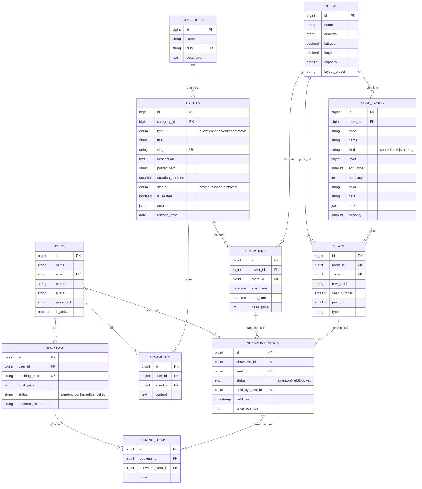

# Sơ đồ quan hệ thực thể (ERD)

Đối chiếu với schema MySQL thật ngày 26/10/2026 (`php artisan migrate:fresh --seed`).

Không vẽ ở đây:
- Các bảng phân quyền `roles`, `permissions`, `model_has_roles`… do `spatie/laravel-permission` tạo.
- Bảng `discounts` (mã giảm giá) — đứng riêng, chưa nối vào đơn đặt vé.
- Các bảng hệ thống của Laravel (`sessions`, `cache`, `jobs`, `password_reset_tokens`).

## Giải thích thiết kế

| Bảng | Vai trò | Ràng buộc đáng chú ý |
|---|---|---|
| `events` | Sự kiện (concert, hòa nhạc, hội thảo, triển lãm…) | `details` JSON chứa địa điểm, lineup, lịch trình, BTC, quy định; `is_seated` = khách chọn ghế trên sơ đồ hay chỉ chọn khu + số lượng |
| `rooms` | Địa điểm tổ chức | `layout_preset` = mẫu bố trí (sân vận động, nhà hát, hội trường, bàn tiệc, không gian mở, lưới tùy chỉnh); `latitude/longitude` cho bản đồ và thời tiết |
| `seat_zones` | Khu vực trong một địa điểm | `kind`: `seated` (ghế đánh số), `table` (ghế quanh bàn), `standing` (khu đứng / vào cửa, có `capacity`); `surcharge` cộng vào giá suất diễn; `unique(room_id, code)` |
| `seats` | Ghế vật lý | Thuộc 1 khu (`zone_id`); `pos_col` = vị trí ô trong hàng, ô trống giữa hai cột chính là lối đi; khu đứng dùng ghế ẩn (`pos_col` rỗng) |
| `showtimes` | Suất diễn của 1 sự kiện tại 1 địa điểm | Không cho 2 suất chồng giờ cùng địa điểm (`Admin/ShowtimeRequest`) |
| `showtime_seats` | Trạng thái từng ghế trong từng suất — **đồng thời là giỏ hàng** | `unique(showtime_id, seat_id)`; `held` + `held_by_user_id` + `held_until` = ghế trong giỏ; `price_override` = giá chốt lúc giữ |
| `bookings` / `booking_items` | Đơn đặt vé và từng vé | `booking_code` duy nhất; `price` là giá đã chốt |
| `comments` | Bình luận sự kiện | Chỉ chủ bình luận hoặc admin được xóa (`CommentPolicy`) |

**Giá vé** = `showtimes.base_price` + `seat_zones.surcharge` (tối thiểu 0). Cùng một địa điểm, mỗi suất có thể đặt giá cơ bản khác nhau.

**Vì sao không có bảng `cart_items`?** Một ghế đang được giữ đã chứa đủ thông tin "ai giữ, tới khi nào, giá bao nhiêu".
Thêm bảng giỏ hàng sẽ tạo hai nguồn sự thật có thể lệch nhau.

**Vì sao khu đứng vẫn có "ghế"?** Mỗi chỗ đứng là một dòng `seats` ẩn. Nhờ vậy vé đứng, vé bàn và vé ghế đi chung một
cơ chế giữ chỗ và chống bán trùng, không cần bảng đếm số lượng riêng.

**Chống đặt trùng ghế:** `SeatHoldService` khóa các dòng `showtime_seats` bằng `SELECT … FOR UPDATE` trong transaction,
chỉ đổi sang `held` nếu ghế đang trống (hoặc giữ đã quá hạn). Hai người bấm cùng lúc: người sau phải chờ khóa, đọc lại thấy ghế đã `held` → nhận lỗi.
Admin xác nhận lại một đơn đã hủy cũng bị chặn nếu ghế đã thuộc đơn khác (`Admin/BookingController@updateStatus`).
