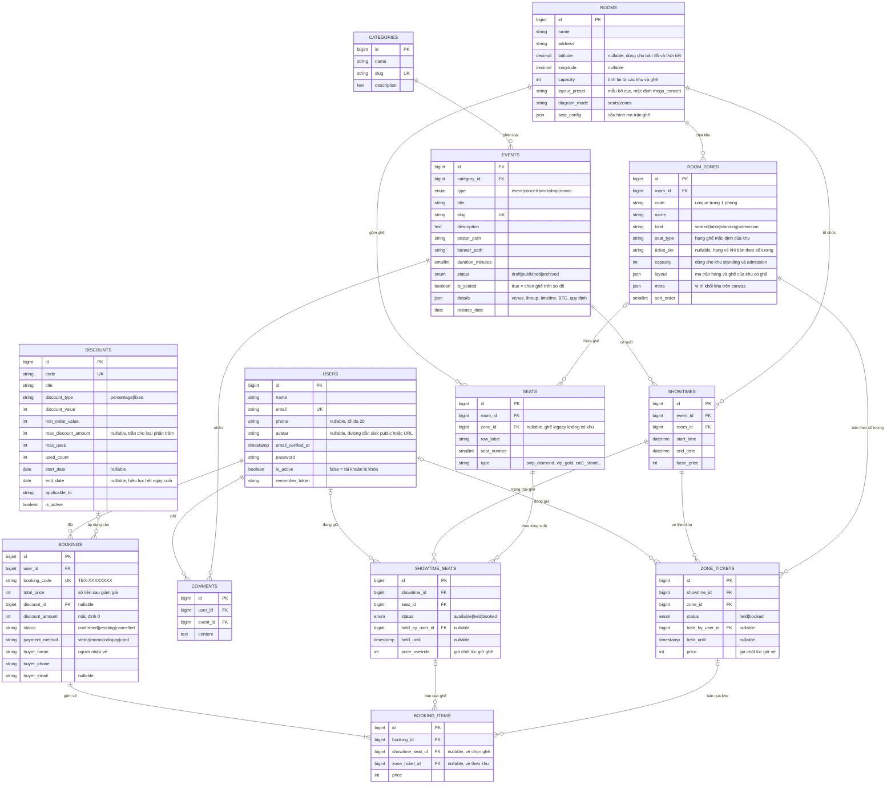

# Sơ đồ quan hệ thực thể (ERD)

Sơ đồ dưới đây khớp với schema sau khi chạy toàn bộ 28 file trong `database/migrations/`
(gồm cả các migration mô hình khu vực `2026_10_*` và thông tin người mua / mã giảm giá `2026_10_19_*`).
Các cột `created_at` / `updated_at` có ở mọi bảng nghiệp vụ nên không vẽ lại.

Các bảng phân quyền `roles`, `permissions`, `model_has_roles`, `model_has_permissions`, `role_has_permissions`
do package `spatie/laravel-permission` tạo (migration `2026_09_07_084118_create_permission_tables.php`), không vẽ ở đây.
Hệ thống chỉ dùng 2 role: `admin` và `user`. Các bảng hạ tầng của Laravel (`sessions`, `password_reset_tokens`,
`cache`, `cache_locks`, `jobs`, `job_batches`, `failed_jobs`) cũng không vẽ.

## Giải thích thiết kế

| Bảng | Vai trò | Ràng buộc đáng chú ý |
|---|---|---|
| `users` | Tài khoản khách và quản trị | `email` duy nhất; `is_active = false` thì bị chặn đăng nhập (`LoginRequest`) và bị đăng xuất nếu đang có phiên (middleware `EnsureUserIsActive`); `phone`, `avatar` sửa ở trang hồ sơ |
| `categories` | Danh mục sự kiện | `slug` duy nhất; không xóa được khi còn sự kiện |
| `events` | Sự kiện (concert, hòa nhạc, hội thảo, triển lãm…) | `details` JSON chứa địa điểm, lineup, lịch trình, BTC, quy định; `is_seated` = chọn ghế trên sơ đồ hay mua theo hạng vé |
| `rooms` | Khán phòng / địa điểm | `diagram_mode`: `seats` (ma trận ghế) hoặc `zones` (sơ đồ theo khu); `layout_preset` quyết định kiểu hiển thị và việc địa điểm có phải ngoài trời không (`Room::isOutdoor()`); `latitude`/`longitude` cho bản đồ và dự báo thời tiết; `capacity` được tính lại tự động (`Room::recalculateCapacity()`) |
| `room_zones` | Khu vực trong khán phòng | `unique(room_id, code)`; `kind` = `seated`/`table` (có ghế thật trong `seats`) hoặc `standing`/`admission` (bán theo số lượng, dùng `capacity`) |
| `seats` | Ghế vật lý | `unique(room_id, row_label, seat_number)`; `zone_id` nullable cho phòng tạo theo ma trận ghế cũ; `type` quyết định hạng giá (`App\Support\TicketTiers`) |
| `showtimes` | Suất diễn của 1 sự kiện tại 1 khán phòng | Không cho 2 suất chồng giờ cùng phòng (kiểm ở `App\Http\Requests\Admin\ShowtimeRequest::after()`) |
| `showtime_seats` | Trạng thái từng ghế trong từng suất — **đồng thời là giỏ hàng cho vé chọn ghế** | `unique(showtime_id, seat_id)`; `held` + `held_by_user_id` + `held_until` = ghế trong giỏ; index `(status, held_until)` cho lệnh dọn ghế hết hạn |
| `zone_tickets` | Vé của khu bán theo số lượng — **đồng thời là giỏ hàng cho vé theo khu** | Chỉ có dòng khi vé đang giữ hoặc đã bán; số vé còn lại = `room_zones.capacity` − số vé `booked` − số vé `held` chưa hết hạn |
| `discounts` | Mã giảm giá | `code` duy nhất (so khớp không phân biệt hoa thường); `used_count` không vượt `max_uses` |
| `bookings` | Đơn đặt vé | `booking_code` duy nhất; `total_price` là số tiền **sau** giảm, `discount_amount` là phần đã giảm; `buyer_*` là người nhận vé (có thể khác chủ tài khoản) |
| `booking_items` | Từng vé trong đơn | Mỗi dòng trỏ tới **đúng một** trong hai: `showtime_seat_id` (vé chọn ghế) hoặc `zone_ticket_id` (vé theo khu); `price` chốt tại lúc giữ chỗ |
| `comments` | Bình luận sự kiện | Chỉ chủ bình luận hoặc admin được xóa (`App\Policies\CommentPolicy`) |

### Trạng thái đơn (`bookings.status`)

Cột là `string(32)` (đã đổi từ enum ở migration `2026_09_23_000001`). Thanh toán giả lập tạo đơn `confirmed`;
admin chỉ chuyển qua lại giữa `confirmed` và `cancelled`. `pending` chỉ còn là nhãn hiển thị (`Booking::STATUS_LABELS`),
không có luồng nào tạo ra. Hủy đơn trả ghế/vé về trạng thái trống và hoàn 1 lượt dùng mã giảm giá; xác nhận lại đơn
chỉ được phép khi mọi ghế/vé vẫn còn trống (xem `App\Http\Controllers\Admin\BookingController::updateStatus`).

### Hai cách bán vé

1. **Chọn ghế** (khu `seated`/`table`, hoặc phòng `diagram_mode = seats`): khi admin tạo suất diễn,
   `ShowtimeSeatGenerator` sinh 1 dòng `showtime_seats` cho mỗi ghế của phòng. Khách chọn ghế trên sơ đồ, hoặc với sự kiện
   `is_seated = false` thì chọn hạng vé + số lượng và server tự gán ghế trống đúng loại. Giữ ghế = đổi dòng sang `held`.
2. **Bán theo số lượng** (khu `standing`/`admission`): không có ghế ảo. Mỗi vé đang giữ hoặc đã bán là 1 dòng
   `zone_tickets`. Để hai người không cùng mua vượt sức chứa, `SeatHoldService` khóa **dòng `room_zones`** của khu bằng
   `lockForUpdate()` rồi mới đếm số vé đang chiếm chỗ; người đến sau phải chờ khóa và đếm lại.

### Thời hạn giữ chỗ

- Giữ chỗ có hạn **10 phút** (`SeatHoldService::HOLD_MINUTES`), mỗi lượt tối đa **8 chỗ** (`MAX_SEATS`),
  mỗi người chỉ giữ chỗ của 1 suất tại một thời điểm.
- **Một đồng hồ chung cho giỏ:** vé giữ thêm sau dùng `held_until` của vé giữ sớm nhất trong giỏ, không gia hạn vé cũ.
  Nhờ vậy cả giỏ hết hạn cùng lúc (không thanh toán thiếu vé) và không ai giữ ghế mãi bằng cách thêm/bỏ vé liên tục.
- Lệnh `seats:release-expired` (`app/Console/Commands/ReleaseExpiredSeatHolds.php`) được lên lịch **mỗi phút**
  trong `routes/console.php`: trả các `showtime_seats` hết hạn về `available` và xóa các `zone_tickets` hết hạn
  (trừ vé thuộc đơn đã hủy, được giữ lại để tra cứu). Kể cả khi lịch không chạy, chỗ quá hạn vẫn được coi là trống.

**Vì sao không có bảng `cart_items`?** Một ghế/vé đang được giữ đã chứa đủ thông tin "ai giữ, tới khi nào, giá bao nhiêu"
(`held_by_user_id`, `held_until`, `price_override` / `price`). Thêm bảng giỏ hàng sẽ tạo hai nguồn sự thật có thể lệch nhau.

**Chống đặt trùng ghế:** `SeatHoldService` (`app/Services/SeatHoldService.php`) chạy trong transaction và khóa các dòng
`showtime_seats` bằng `SELECT … FOR UPDATE`, chỉ đổi sang `held` nếu ghế đang trống (hoặc lượt giữ cũ đã quá hạn) — tất cả
hoặc không gì cả. Hai người bấm cùng lúc: người sau phải chờ khóa, đọc lại thấy ghế đã `held` → nhận lỗi. Ngoài ra dòng `users`
của người giữ cũng bị khóa để hai request song song của cùng một người không cùng vượt giới hạn 8 chỗ. Khi thanh toán,
`CheckoutService` khóa lại các ghế/vé đang giữ và dòng `discounts` (nếu có mã) trước khi tạo đơn.
