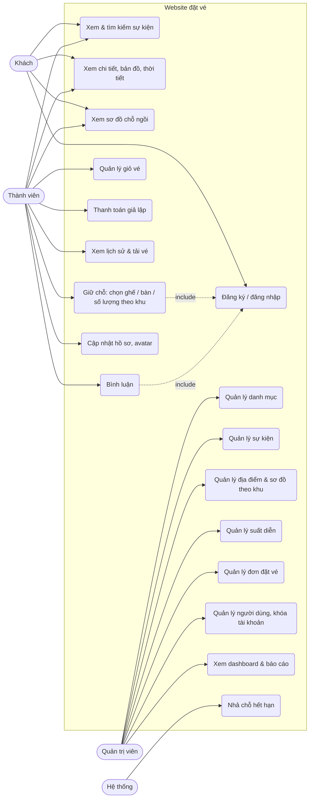

# Use Case

## Tác nhân

| Tác nhân | Mô tả |
|---|---|
| Khách (chưa đăng nhập) | Xem, tìm kiếm sự kiện, xem bản đồ / thời tiết / sơ đồ chỗ ngồi |
| Thành viên (`user`) | Mọi quyền của Khách + giữ chỗ, thanh toán, xem lịch sử, bình luận, sửa hồ sơ |
| Quản trị viên (`admin`) | Quản lý danh mục, sự kiện, địa điểm & sơ đồ, suất diễn, đơn đặt vé, người dùng; xem thống kê |
| Hệ thống (lịch chạy mỗi phút) | Nhả chỗ giữ quá hạn |

## Sơ đồ

## Đặc tả use case chính

### UC1 — Xem & tìm kiếm sự kiện
- **Tác nhân:** Khách, Thành viên
- **Tiền điều kiện:** Không có.
- **Luồng chính:**
  1. Người dùng mở `/events`, nhập từ khóa và/hoặc chọn danh mục.
  2. Hệ thống trả các sự kiện đang mở bán khớp tên hoặc mô tả, 9 sự kiện mỗi trang, kèm giá thấp nhất.
  3. Khi gõ vào ô tìm kiếm trên thanh menu, sau 0,25 giây hệ thống gợi ý tối đa 6 sự kiện (AJAX `GET /search/suggestions`).
- **Luồng thay thế:** từ khóa dưới 2 ký tự → không gợi ý; quá 100 ký tự → báo lỗi; sự kiện nháp không bao giờ hiện.
- **Code:** `app/Http/Controllers/EventController.php`, `app/Http/Controllers/SearchSuggestionController.php`

### UC5 — Giữ chỗ
- **Tác nhân:** Thành viên
- **Tiền điều kiện:** Đã đăng nhập, tài khoản không bị khóa, suất diễn chưa bắt đầu, sự kiện đang mở bán.
- **Luồng chính:**
  1. Thành viên mở sơ đồ của một suất. Tùy khu: bấm từng ghế (khu ghế), bấm ghế hoặc "Chọn cả bàn" (khu bàn), chọn số lượng (khu đứng). Sự kiện không có sơ đồ thì chọn số lượng cho từng khu. Tối đa 8 vé.
  2. Bấm "Xác Nhận Giữ Chỗ" → trình duyệt gửi AJAX `POST /showtimes/{id}/holds` với `seat_ids` và `zones`.
  3. Hệ thống khóa các ghế, kiểm tra còn trống, với khu theo số lượng thì tự gán ghế trống đầu tiên; chuyển sang "đang giữ" 10 phút và chốt giá theo khu.
  4. Chuyển tới giỏ vé với đồng hồ đếm ngược.
- **Luồng thay thế:**
  - 2a. Chưa đăng nhập → chuyển tới trang đăng nhập.
  - 3a. Có ghế vừa bị người khác giữ/bán → báo "Ghế … vừa có người giữ", không giữ ghế nào (tất cả hoặc không).
  - 3b. Khu không đủ chỗ → báo "Khu "…" chỉ còn N chỗ".
  - 3c. Gửi khu của địa điểm khác, hoặc chọn số lượng cho khu ghế đánh số → báo lỗi, không giữ gì.
- **Hậu điều kiện:** Ghế ở trạng thái `held` của thành viên; nếu không thanh toán trong 10 phút, ghế tự trống lại.
- **Code:** `app/Services/SeatHoldService.php`, `app/Http/Controllers/SeatHoldController.php`

### UC7 — Thanh toán giả lập
- **Tác nhân:** Thành viên
- **Tiền điều kiện:** Giỏ vé có ghế còn hạn giữ.
- **Luồng chính:** chọn phương thức (VietQR / MoMo / ZaloPay / Thẻ) → bấm xác nhận → hệ thống tạo đơn `confirmed`, mã `TBX-XXXXXXXX`, ghế chuyển `booked` → hiện vé điện tử.
- **Luồng thay thế:** giỏ trống hoặc hết hạn → báo lỗi, không tạo đơn.
- **Code:** `app/Services/CheckoutService.php`

### UC9 — Bình luận
- **Tác nhân:** Thành viên (Quản trị viên được xóa mọi bình luận)
- **Tiền điều kiện:** Đã đăng nhập; sự kiện đang mở bán.
- **Luồng chính:**
  1. Thành viên nhập nội dung ở trang chi tiết sự kiện, bấm "Gửi".
  2. Hệ thống kiểm tra 3–1000 ký tự, lưu và trả bình luận dạng JSON; bình luận hiện ngay đầu danh sách, không tải lại trang.
  3. Chủ bình luận (hoặc admin) bấm "Xóa" → bình luận biến mất.
- **Luồng thay thế:** chưa đăng nhập → chuyển tới trang đăng nhập; nội dung không hợp lệ → hiện lỗi dưới ô nhập; người khác bấm xóa → 403; gửi quá 10 lần/phút → bị chặn tạm thời.
- **Code:** `app/Http/Controllers/CommentController.php`, `app/Policies/CommentPolicy.php`, `app/Http/Requests/StoreCommentRequest.php`

### UC12 — Quản lý sự kiện
- **Tác nhân:** Quản trị viên
- **Tiền điều kiện:** Đăng nhập tài khoản admin.
- **Luồng chính:** nhập tên, danh mục, trạng thái (nháp / mở bán / lưu trữ), có chọn ghế hay không, thời lượng, mô tả, upload poster (jpg/png/webp ≤ 2MB) và các thông tin chi tiết (địa điểm, lineup, lịch trình…) → hệ thống lưu, poster vào disk `public`.
- **Luồng thay thế:** thiếu trường bắt buộc → thông báo lỗi tiếng Việt; xóa sự kiện đã bán vé → bị từ chối, gợi ý chuyển sang "Lưu trữ".
- **Code:** `app/Http/Controllers/Admin/EventController.php`, `app/Http/Requests/Admin/EventRequest.php`

### UC13 — Quản lý địa điểm & sơ đồ theo khu
- **Tác nhân:** Quản trị viên
- **Tiền điều kiện:** Đăng nhập tài khoản admin.
- **Luồng chính:**
  1. Chọn một trong 6 mẫu (sân vận động, nhà hát, hội trường, bàn tiệc, không gian mở, lưới tùy chỉnh).
  2. Sửa tên, phụ thu, màu, cổng, mô tả từng khu; thêm khu ghế / khu bàn / khu đứng; tô ô bằng khu hoặc khoét lối đi; nhập tọa độ.
  3. Lưu → hệ thống kiểm tra sơ đồ rồi sinh khu và ghế.
- **Luồng thay thế:** nhãn hàng trùng, ô trỏ khu không tồn tại, dữ liệu hỏng, quá 5.000 chỗ → báo lỗi, sơ đồ cũ giữ nguyên; địa điểm đã có suất diễn → chỉ cập nhật tên/giá/màu/mô tả của khu, không đổi ghế; xóa địa điểm đã có suất → bị từ chối. Có nút "Nhân bản" để vẽ sơ đồ mới từ địa điểm cũ.
- **Code:** `app/Http/Controllers/Admin/RoomController.php`, `app/Http/Requests/RoomLayoutRequest.php`, `app/Support/LayoutTemplates.php`, `app/Services/RoomSeatGenerator.php`

### UC14 — Quản lý suất diễn
- **Tác nhân:** Quản trị viên
- **Luồng chính:** chọn sự kiện, địa điểm, giờ bắt đầu/kết thúc, giá cơ bản → hệ thống kiểm tra không chồng giờ → tạo suất và sinh trạng thái cho từng ghế.
- **Ràng buộc:** không xóa/đổi địa điểm của suất đã bán vé.
- **Code:** `app/Http/Controllers/Admin/ShowtimeController.php`, `app/Http/Requests/Admin/ShowtimeRequest.php`

### UC16 — Quản lý người dùng, khóa tài khoản
- **Tác nhân:** Quản trị viên
- **Tiền điều kiện:** Đăng nhập tài khoản admin.
- **Luồng chính:** tìm / lọc người dùng → bấm khóa hoặc mở khóa (AJAX) → người bị khóa bị đăng xuất ngay ở request kế tiếp và không đăng nhập lại được; ngoài ra có thể đổi vai trò admin/user và tạo tài khoản mới.
- **Luồng thay thế:** admin tự khóa hoặc tự đổi vai trò của chính mình → bị từ chối.
- **Code:** `app/Http/Controllers/Admin/UserController.php`, `app/Http/Middleware/EnsureUserIsActive.php`
