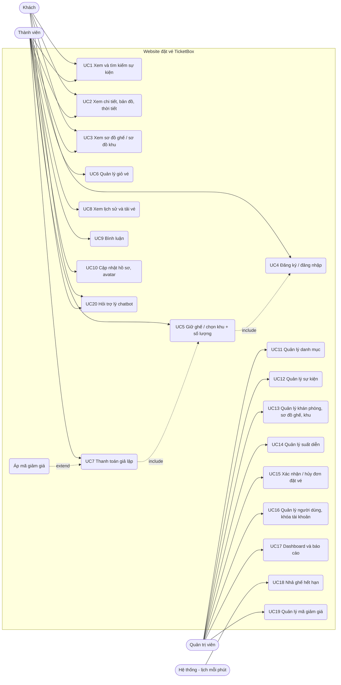

# Use Case

Mọi mô tả dưới đây đối chiếu với code trên nhánh hiện tại; đường dẫn file ghi ở cuối mỗi đặc tả để người chấm kiểm tra.

## Tác nhân

| Tác nhân | Mô tả |
|---|---|
| Khách (chưa đăng nhập) | Xem trang chủ, tìm kiếm/lọc sự kiện, xem chi tiết (bản đồ, thời tiết), xem sơ đồ ghế/sơ đồ khu, đọc bình luận, hỏi chatbot, đăng ký/đăng nhập |
| Thành viên (role `user`) | Mọi quyền của Khách + giữ ghế/giữ vé theo khu, quản lý giỏ vé, áp mã giảm giá, thanh toán giả lập, xem lịch sử và tải vé PNG, bình luận, cập nhật hồ sơ + avatar |
| Quản trị viên (role `admin`) | Quản lý danh mục, sự kiện, khán phòng (theo ghế hoặc theo khu), suất diễn, đơn đặt vé, mã giảm giá, người dùng; xem dashboard và báo cáo doanh thu |
| Hệ thống (lịch chạy mỗi phút) | Lệnh `seats:release-expired` nhả ghế/vé giữ quá hạn |

Hệ thống chỉ có 2 role `admin` và `user` (spatie/laravel-permission). Người đăng ký mới được gán `user` (`app/Http/Controllers/Auth/RegisteredUserController.php`).

## Sơ đồ

Ghi chú: Quản trị viên cũng đăng nhập bằng UC4 và có thể dùng các chức năng của Thành viên; sơ đồ chỉ vẽ phần đặc thù của từng tác nhân cho gọn.

## Đặc tả use case chính

### UC1 — Xem và tìm kiếm sự kiện
- **Tác nhân:** Khách, Thành viên.
- **Tiền điều kiện:** Không có. Chỉ sự kiện trạng thái `published` được hiển thị.
- **Luồng chính:**
  1. Người dùng mở `/events` (hoặc trang chủ `/`).
  2. Nhập từ khóa vào ô tìm kiếm (`q`, tối đa 100 ký tự) và/hoặc chọn danh mục (`category`).
  3. Hệ thống lọc sự kiện có tiêu đề **hoặc** mô tả chứa từ khóa, đúng danh mục; hiển thị 9 sự kiện/trang kèm giá thấp nhất và suất gần nhất; giữ tham số lọc khi chuyển trang.
  4. Tìm kiếm nhanh: mở hộp tìm kiếm ở header, gõ từ 2 ký tự → trình duyệt gọi AJAX `GET /search/suggestions?q=…` → hiện tối đa 6 sự kiện có tiêu đề khớp (poster, danh mục, giá từ), bấm để tới trang chi tiết.
- **Luồng thay thế:**
  - 3a. Không có kết quả → trang hiện trạng thái rỗng, không lỗi.
  - 4a. Gõ dưới 2 ký tự → không tìm, trả danh sách "sự kiện nổi bật" (6 sự kiện mới nhất).
  - 4b. Ký tự `%`, `_` trong từ khóa được escape nên tìm đúng như chữ thường.
  - 4c. Gọi gợi ý quá 60 lần/phút → bị `throttle` chặn (HTTP 429).
- **Hậu điều kiện:** Không thay đổi dữ liệu.
- **Code:** `app/Http/Controllers/EventController.php` (`index`), `app/Http/Controllers/SearchSuggestionController.php`, `resources/js/app.js` (`searchModal`).

### UC5 — Giữ ghế / chọn khu + số lượng
- **Tác nhân:** Thành viên.
- **Tiền điều kiện:** Đã đăng nhập, tài khoản không bị khóa, sự kiện đang `published`, suất diễn chưa bắt đầu.
- **Luồng chính:** người dùng mở `/showtimes/{id}/seats`. Màn hình tùy theo loại khán phòng:
  1. **Khán phòng theo ghế** (nhà hát, ví dụ Nhà Hát Thành Phố) với sự kiện chọn ghế: chọn ghế trên sơ đồ (tối đa 8), xem giá theo hạng ghế, phóng to/thu nhỏ, lọc theo khu.
  2. **Khán phòng theo khu** (sân vận động, trung tâm hội nghị): sơ đồ khu hiện từng khu kèm giá và số chỗ còn. Khu **ghế ngồi/bàn** → bấm "Chọn ghế khu này" để mở sơ đồ ghế riêng của khu và chọn ghế; khu **đứng/vé vào cửa** → chọn số lượng bằng nút +/−.
  3. **Sự kiện không chọn ghế** ở khán phòng theo ghế (ví dụ Fan Meeting): chọn hạng vé (VIP, Tiêu chuẩn, Combo 2 người) + số lượng; server tự gán ghế trống đúng loại.
  4. Bấm "Xác Nhận Giữ Chỗ" (sơ đồ ghế) hoặc "Giữ vé" (sơ đồ khu) → AJAX `POST /showtimes/{id}/holds` với `seat_ids`, `tiers`, `zones`.
  5. `SeatHoldService::hold()` chạy trong một transaction: khóa dòng user; nhả các vé user đang giữ ở **suất khác**; kiểm tra tổng không quá 8 chỗ; khóa các dòng `showtime_seats` được chọn bằng `lockForUpdate()` rồi mới kiểm tra còn trống; với khu theo số lượng thì khóa dòng `room_zones`, đếm vé đã bán/đang giữ so với sức chứa rồi tạo các dòng `zone_tickets`. Ghế/vé chuyển sang "đang giữ" với giá được chốt và hạn giữ 10 phút (giỏ có một đồng hồ chung: vé giữ thêm dùng hạn của vé giữ sớm nhất).
  6. Trả JSON, trình duyệt chuyển tới giỏ vé `/cart` có đồng hồ đếm ngược.
- **Luồng thay thế:**
  - 4a. Chưa đăng nhập → server trả 401, trình duyệt chuyển tới trang đăng nhập.
  - 5a. Có ghế vừa bị người khác giữ/bán → báo "Ghế … vừa có người giữ hoặc đã bán. Vui lòng chọn ghế khác.", **không giữ ghế nào** (tất cả hoặc không); trình duyệt tải lại trạng thái ghế ngay.
  - 5b. Hạng vé không đủ chỗ → "Hạng vé "…" chỉ còn N chỗ."; khu theo số lượng không đủ → "Khu … chỉ còn N vé."
  - 5c. Vượt giới hạn → "Mỗi lượt đặt tối đa 8 chỗ (bạn đang giữ N chỗ)."
  - 5d. Sự kiện không mở bán / suất đã bắt đầu → báo lỗi tương ứng, không giữ.
  - Trong lúc đang xem sơ đồ: mỗi 15 giây trình duyệt gọi `GET /showtimes/{id}/seat-status`; ghế người khác vừa giữ chuyển xám và hiện thông báo "Ghế … vừa được người khác giữ."; số chỗ còn của từng khu cũng được cập nhật.
- **Hậu điều kiện:** Ghế ở trạng thái `held` (bảng `showtime_seats`) hoặc vé khu ở trạng thái `held` (bảng `zone_tickets`) thuộc thành viên. Quá 10 phút không thanh toán: ghế được coi là trống ngay (scope `holdable`), lệnh `seats:release-expired` dọn dữ liệu mỗi phút.
- **Code:** `app/Http/Controllers/SeatHoldController.php`, `app/Http/Requests/HoldSeatsRequest.php`, `app/Services/SeatHoldService.php`, `app/Http/Controllers/ShowtimeController.php`, `resources/views/components/seat-map.blade.php`, `resources/views/components/seat-map-zoned.blade.php`, `resources/js/app.js` (`seatBookingManager`).

### UC7 — Thanh toán giả lập
- **Tác nhân:** Thành viên.
- **Tiền điều kiện:** Giỏ vé có ít nhất một ghế/vé còn hạn giữ.
- **Luồng chính:**
  1. Thành viên mở `/cart`: danh sách vé đang giữ, tạm tính, đồng hồ đếm ngược; có thể "Bỏ vé" từng vé (AJAX `DELETE /cart/seats/{id}` hoặc `/cart/zone-tickets/{id}`).
  2. (Tùy chọn — mở rộng "Áp mã giảm giá") nhập mã, bấm "Áp dụng" → AJAX `POST /cart/discount` → hệ thống tính lại tạm tính phía server và trả số tiền được giảm để xem trước.
  3. Điền thông tin người nhận vé: **họ tên** và **số điện thoại** (bắt buộc), email (tùy chọn); mặc định lấy từ tài khoản.
  4. Chọn phương thức: VietQR, MoMo, ZaloPay hoặc Thẻ quốc tế → bấm "Tiến Hành Thanh Toán".
  5. Màn hình thanh toán: với VietQR/MoMo/ZaloPay hiện mã QR ghi rõ "Mã QR minh họa – không chuyển tiền"; với thẻ, hệ thống **không thu thông tin thẻ** (số thẻ, CVV…). Bấm "Xác nhận đã hoàn tất thanh toán" → AJAX `POST /checkout`.
  6. `CheckoutService::checkout()` trong một transaction: khóa các ghế/vé đang giữ, kiểm tra lại sự kiện còn mở bán và suất chưa bắt đầu, tính tạm tính; nếu có mã giảm giá thì khóa dòng mã, kiểm tra lại và tăng `used_count`; tạo đơn `confirmed` với mã `TBX-XXXXXXXX`, lưu người nhận vé, tiền giảm; tạo `booking_items`; chuyển ghế/vé sang `booked`.
  7. Hiện vé điện tử (QR chứa mã đặt vé), có nút tải ảnh vé PNG; đơn xuất hiện ở `/bookings`.
- **Luồng thay thế:**
  - 6a. Giỏ trống hoặc hết hạn → "Giỏ vé trống hoặc đã hết thời gian giữ chỗ. Vui lòng chọn lại ghế.", không tạo đơn.
  - 2a/6b. Mã giảm giá không dùng được → báo đúng lý do: không tồn tại/ngừng áp dụng, chưa đến thời gian, đã hết hạn, hết lượt sử dụng, đơn chưa đạt giá trị tối thiểu. Không tạo đơn.
  - 3a. Thiếu họ tên/số điện thoại hoặc số điện thoại sai định dạng → lỗi validation tiếng Việt (HTTP 422), trình duyệt quay lại bước nhập thông tin.
  - 6c. Admin vừa ẩn sự kiện hoặc suất đã bắt đầu → "… không thể thanh toán."
- **Hậu điều kiện:** Có đơn `bookings` trạng thái `confirmed`, ghế/vé `booked`; tổng tiền = tạm tính − tiền giảm. Không có giao dịch tiền thật.
- **Code:** `app/Http/Controllers/CartController.php`, `app/Http/Controllers/CheckoutController.php`, `app/Http/Requests/CheckoutRequest.php`, `app/Services/CheckoutService.php`, `app/Services/DiscountService.php`, `app/Models/Discount.php`, `resources/views/cart/index.blade.php`, `resources/js/app.js` (`ticketPaymentManager`).

### UC9 — Bình luận
- **Tác nhân:** Thành viên (viết, xóa của mình), Quản trị viên (xóa mọi bình luận), Khách (chỉ đọc).
- **Tiền điều kiện:** Sự kiện đang `published`. Viết/xóa cần đăng nhập.
- **Luồng chính:**
  1. Trang chi tiết sự kiện render sẵn 10 bình luận mới nhất; bấm "xem thêm" → AJAX `GET /events/{slug}/comments?cursor=…` (phân trang theo con trỏ, 10/lần).
  2. Thành viên nhập nội dung (3–1000 ký tự) → AJAX `POST /events/{slug}/comments` → bình luận mới hiện ngay đầu danh sách, không tải lại trang.
  3. Người viết (hoặc admin) bấm xóa → AJAX `DELETE /comments/{id}` → `CommentPolicy::delete` cho phép → bình luận biến mất.
- **Luồng thay thế:**
  - 2a. Nội dung quá ngắn/quá dài → lỗi validation 422; gửi quá 10 bình luận/phút → 429.
  - 3a. Người không phải chủ bình luận và không phải admin → 403.
  - 1a. Con trỏ phân trang bị sửa tay sai định dạng → 400 thay vì lỗi 500.
- **Hậu điều kiện:** Bảng `comments` thêm/bớt dòng. Nội dung luôn render bằng `x-text` (không `x-html`) để tránh XSS.
- **Code:** `app/Http/Controllers/CommentController.php`, `app/Policies/CommentPolicy.php`, `app/Http/Requests/StoreCommentRequest.php`, `resources/js/app.js` (`eventComments`).

### UC12 — Quản lý sự kiện
- **Tác nhân:** Quản trị viên.
- **Tiền điều kiện:** Đăng nhập với role `admin` (route `admin.*` + middleware `role:admin`).
- **Luồng chính:**
  1. Mở `/admin/events`: danh sách 10/trang, tìm theo tên, lọc theo danh mục và trạng thái.
  2. Thêm/sửa: nhập tên, danh mục, trạng thái (`draft`/`published`/`archived`), cờ "chọn ghế trên sơ đồ" (`is_seated`), thời lượng, ngày mở bán, mô tả, upload poster (jpg/png/webp ≤ 2MB), thông tin địa điểm/MC/khách mời, lineup và lịch trình (mỗi dòng `a | b | c`).
  3. `EventRequest` kiểm tra dữ liệu; poster lưu vào disk `public` thư mục `posters/` (poster cũ bị xóa khi thay); lineup/lịch trình được gộp vào cột JSON `details`, giữ nguyên các khóa chi tiết mà form không quản lý.
  4. Lưu → quay về danh sách với thông báo thành công. Chỉ sự kiện `published` xuất hiện ngoài trang public.
- **Luồng thay thế:**
  - 3a. Thiếu tên/danh mục, poster sai định dạng hoặc quá lớn → thông báo lỗi tiếng Việt cạnh từng ô.
  - Xóa sự kiện đã phát sinh đơn (kể cả đơn đã hủy) → bị từ chối, gợi ý chuyển sang "Lưu trữ".
- **Hậu điều kiện:** Bảng `events` cập nhật; file poster trong `storage/app/public/posters` (cần `php artisan storage:link`).
- **Code:** `app/Http/Controllers/Admin/EventController.php`, `app/Http/Requests/Admin/EventRequest.php`, `resources/views/admin/events/form.blade.php`.

### UC13 — Quản lý khán phòng, sơ đồ ghế và khu
- **Tác nhân:** Quản trị viên.
- **Tiền điều kiện:** Đăng nhập với role `admin`.
- **Luồng chính:**
  1. `/admin/rooms/create` hỏi chọn kiểu sơ đồ: **theo ghế** hoặc **theo khu**.
  2. **Theo ghế:** trình thiết kế ma trận ghế — chọn mẫu bố cục (nhà hát, hội trường…) hoặc tự vẽ từng hàng, đánh dấu loại ghế (SVIP, VIP, Cat 1, Cat 2, Skybox) và lối đi → `RoomSeatGenerator` sinh bảng `seats`.
  3. **Theo khu:** trình thiết kế khu — chọn mẫu (sân khấu ngoài trời, nhà hát, hội trường, hội nghị theo bàn, vé vào cửa), thêm/sửa từng khu với mã, tên, loại khu (`seated` ghế ngồi, `table` bàn, `standing` khu đứng, `admission` vé vào cửa), hạng vé, số hàng × số ghế hoặc sức chứa, vị trí/hình dạng khu trên canvas → `ZoneLayoutGenerator` tạo `room_zones`, sinh ghế cho khu ngồi/bàn; khu đứng/vé vào cửa chỉ lưu sức chứa (bán theo số lượng qua `zone_tickets`). Sức chứa phòng tự tính lại bằng tổng các khu.
  4. Nhập tên, địa chỉ, tọa độ (dùng cho bản đồ và thời tiết) → Lưu (toàn bộ trong một transaction).
  5. "Nhân bản" (`POST /admin/rooms/{id}/duplicate`) tạo bản sao phòng kèm khu và ghế để sửa sơ đồ mới.
- **Luồng thay thế:**
  - 3a. Mã khu trùng, khu đứng/vé vào cửa có sức chứa 0, số ghế không phải số nguyên dương, ghế trùng trong một hàng, tên hàng quá dài → báo lỗi, không lưu.
  - 4a. Khán phòng **đã có suất diễn**: không sinh lại ghế/khu (tránh xóa vé đã bán) — chỉ cập nhật tên/địa chỉ, gợi ý dùng "Nhân bản".
  - Xóa khán phòng đã có suất diễn → bị từ chối.
- **Hậu điều kiện:** Bảng `rooms`, `room_zones`, `seats` cập nhật.
- **Code:** `app/Http/Controllers/Admin/RoomController.php`, `app/Services/RoomSeatGenerator.php`, `app/Services/ZoneLayoutGenerator.php`, `app/Support/VenuePresets.php`, `resources/views/admin/rooms/choose-layout.blade.php`, `resources/views/admin/rooms/builder.blade.php`, `resources/views/admin/rooms/zoned-builder.blade.php`.

### UC14 — Quản lý suất diễn
- **Tác nhân:** Quản trị viên.
- **Tiền điều kiện:** Đã có sự kiện và khán phòng.
- **Luồng chính:**
  1. `/admin/showtimes`: danh sách 10/trang, lọc theo sự kiện, khán phòng.
  2. Thêm suất: chọn sự kiện, khán phòng, giờ bắt đầu/kết thúc, giá cơ bản (10.000–50.000.000₫).
  3. `ShowtimeRequest` kiểm tra giờ bắt đầu ở tương lai, giờ kết thúc sau giờ bắt đầu và **không chồng giờ** với suất khác cùng khán phòng.
  4. Trong một transaction: tạo suất và `ShowtimeSeatGenerator` sinh một dòng `showtime_seats` (trạng thái `available`) cho mỗi ghế của phòng. Vé khu đứng/vé vào cửa không cần sinh trước.
- **Luồng thay thế:**
  - 3a. Trùng khung giờ → "Khán phòng đã có suất diễn khác trùng khung giờ này."
  - Sửa: không cho đổi sự kiện khi suất đã có đơn; không cho đổi khán phòng khi đã có ghế đang giữ/đã bán hoặc vé khu; suất đã diễn ra vẫn sửa được giá/giờ kết thúc nếu giữ nguyên giờ bắt đầu.
  - Xóa suất đã phát sinh đơn (kể cả đơn đã hủy) → bị từ chối.
- **Hậu điều kiện:** Bảng `showtimes` + `showtime_seats` cập nhật.
- **Code:** `app/Http/Controllers/Admin/ShowtimeController.php`, `app/Http/Requests/Admin/ShowtimeRequest.php`, `app/Services/ShowtimeSeatGenerator.php`.

### UC16 — Quản lý người dùng, khóa tài khoản
- **Tác nhân:** Quản trị viên.
- **Tiền điều kiện:** Đăng nhập với role `admin`.
- **Luồng chính:**
  1. `/admin/users`: thẻ thống kê (tổng, đang hoạt động, bị khóa, số admin); tìm theo tên/email/số điện thoại; lọc theo vai trò và trạng thái; 10/trang.
  2. Tạo tài khoản mới với vai trò `admin` hoặc `user`.
  3. Khóa/mở khóa: AJAX `PATCH /admin/users/{id}/toggle-status` đổi `is_active`, cập nhật nhãn trên dòng không tải lại trang.
  4. Đổi vai trò admin ↔ user (`PATCH …/toggle-role`).
  5. Đặt lại mật khẩu (`POST …/reset-password`): sinh mật khẩu ngẫu nhiên 10 ký tự, hiển thị một lần cho admin, đổi `remember_token` và xóa các phiên đăng nhập của user đó (session driver `database`).
- **Luồng thay thế:**
  - 3a/4a. Admin tự khóa hoặc tự đổi vai trò của chính mình → bị từ chối.
  - Người bị khóa: ở request kế tiếp, middleware `EnsureUserIsActive` đăng xuất ngay và chuyển về trang đăng nhập với thông báo "Tài khoản của bạn đã bị tạm khóa…" (request AJAX nhận 403); đăng nhập lại cũng bị `LoginRequest` chặn.
- **Hậu điều kiện:** `users.is_active`, role hoặc mật khẩu được cập nhật.
- **Code:** `app/Http/Controllers/Admin/UserController.php`, `app/Http/Middleware/EnsureUserIsActive.php`, `app/Http/Requests/Auth/LoginRequest.php`, `resources/views/admin/users/index.blade.php`.

## Các use case còn lại (tóm tắt)

| UC | Tóm tắt | Code |
|---|---|---|
| UC2 | Chi tiết sự kiện: lineup, lịch trình, suất sắp tới, bản đồ Google Maps của khán phòng suất gần nhất + nút chỉ đường; dự báo thời tiết chỉ cho địa điểm ngoài trời, trong 5 ngày tới và khi có `OPENWEATHER_API_KEY` | `app/Http/Controllers/EventController.php` (`show`), `app/Support/MapEmbed.php`, `app/Services/WeatherService.php` |
| UC3 | Khách xem được sơ đồ ghế/sơ đồ khu, chỉ bị yêu cầu đăng nhập khi bấm giữ | `app/Http/Controllers/ShowtimeController.php` |
| UC4 | Đăng ký, đăng nhập, quên mật khẩu (Laravel Breeze) | `routes/auth.php` |
| UC6 | Giỏ vé: xem, bỏ từng vé, đồng hồ đếm ngược | `app/Http/Controllers/CartController.php`, `app/Http/Controllers/SeatHoldController.php` |
| UC8 | Lịch sử đơn `/bookings`, tải ảnh vé PNG | `app/Http/Controllers/BookingController.php`, `resources/views/bookings/history.blade.php` |
| UC10 | Sửa hồ sơ, số điện thoại, avatar (≤ 2MB), đổi mật khẩu | `app/Http/Controllers/ProfileController.php` |
| UC11 | CRUD danh mục, tìm kiếm, sắp xếp, xóa nhiều | `app/Http/Controllers/Admin/CategoryController.php` |
| UC15 | Xem đơn, xác nhận/hủy đơn (hủy thì nhả ghế, trả lượt mã giảm giá; xác nhận lại chỉ khi ghế còn trống) | `app/Http/Controllers/Admin/BookingController.php` |
| UC17 | Dashboard KPI, tỉ lệ lấp đầy, doanh thu theo danh mục/sự kiện, bản in báo cáo | `app/Http/Controllers/Admin/DashboardController.php`, `app/Http/Controllers/Admin/ReportController.php`, `app/Services/SalesReportService.php` |
| UC18 | Nhả ghế/vé khu giữ quá hạn | `app/Console/Commands/ReleaseExpiredSeatHolds.php`, `routes/console.php` |
| UC19 | CRUD mã giảm giá (phần trăm/cố định, đơn tối thiểu, giảm tối đa, số lượt, thời hạn), bật/tắt | `app/Http/Controllers/Admin/DiscountController.php` |
| UC20 | Chatbot hỏi đáp dùng Gemini với dữ liệu sự kiện thật | `app/Http/Controllers/ChatbotController.php`, `app/Services/GeminiChatService.php` |
